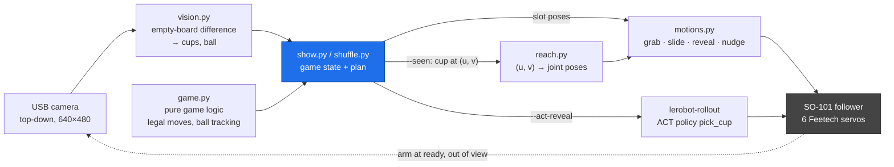
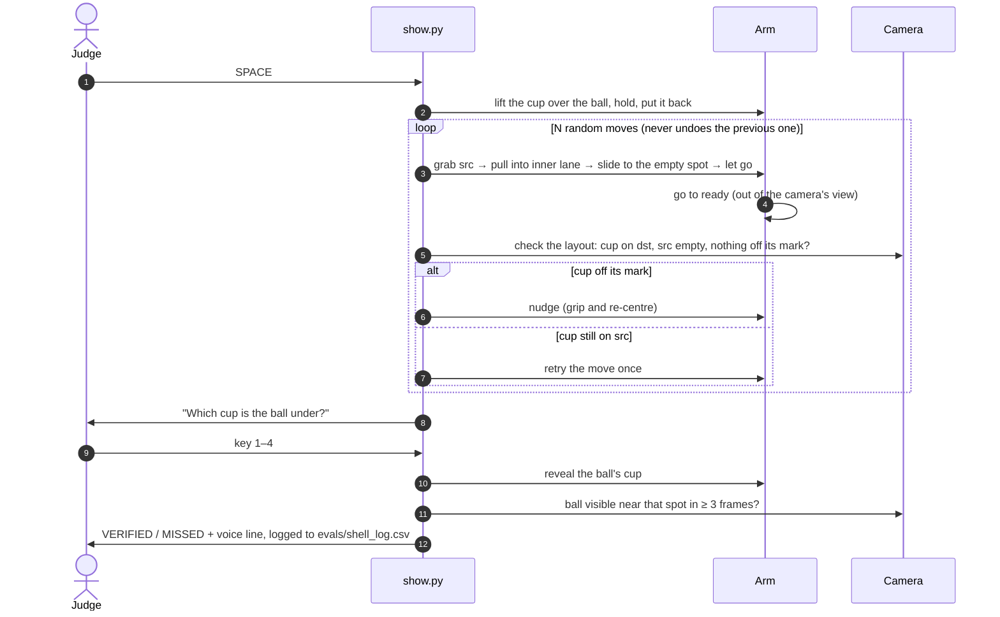

<h1 align="center">HickHack: The Robot Magician</h1>

<p align="center">
  <strong>A robot arm that plays the cup game against you, then uses its own camera to show it played fair.</strong><br/>
  SO-101 arm · taught motions · camera-guided grasping · learned ACT reveal · on-device vision checks
</p>

<p align="center">
  
  
  
  
  
  
  
</p>

<p align="center">
  <br/>
  <sub>What the robot sees: three cups on the board, filmed from above by the fixed camera. Cups are found by brightness against a photo of the empty board.</sub>
</p>

> **Summit Sprint Hackathon (AustrianStartups), 42 Vienna, 14–15 October 2026. Robotics track:**
> *"Teach our robot something it couldn't do before. What counts is what the robot shows live on stage."*

---

## What it is

The robot plays the **shell game**. It shows you the ball, slides three cups around four marked spots, asks
which cup the ball is under, and lifts the one it chose. While the cup is in the air, the camera checks that
the ball is really there, and the screen shows **VERIFIED** or **MISSED**.

<p align="center"><code>show the ball</code> → <code>shuffle N moves</code> → <code>"Which cup?"</code> → <code>reveal</code> → <code>camera: VERIFIED</code></p>

A shell game run by a person depends on misdirection. Ours works the other way: the robot keeps track of the ball
in code, the camera checks the table after every move, and the final check is shown on screen.

- 🎩 **The show.** One window: the live camera, a large status title, and a spoken voice line at each step. Keys: SPACE to play, 1–4 to guess, ESC to stop.
- 🦾 **Taught motions, not hard-coded coordinates.** Every pose was shown to the robot with the leader arm (`teach.py`), and the arm moves between poses with smooth ease-in/out curves.
- 👁️ **Camera-guided grasping (`--seen`).** The camera finds each cup, and a reach model trained on the taught examples predicts the arm pose for wherever the cup actually is.
- ✅ **A camera check after every move.** If a cup is still on its old spot, the robot tries once more. If a cup is off its mark, the robot nudges it back. If something is wrong that the robot can't fix, it asks the operator for help instead of carrying on.
- 🧠 **Learned reveal (`--act-reveal`).** The reveal can optionally be done by an **ACT** neural network policy trained from teleoperated demos. If that rollout fails, the scripted reveal runs instead.
- 🛟 **Safe by default.** Each command can move a joint at most 10° (`max_relative_target`). ESC freezes the arm where it is. Every script ends by moving slowly to `home` and switching the motors off.

---

## How it works



Three things are kept separate: the **game logic** (pure Python with no hardware dependencies, fully unit-tested),
the **motion** (taught poses and smooth interpolation), and the **perception** (deterministic OpenCV with no
AI model). Each can be tested on its own, and each has a `--fake` mode.

### One game, end to end



### The four building blocks

| Module | What it does | How |
|---|---|---|
| [`game.py`](shellgame/game.py) | Tracks the 3 cups, 4 spots and the ball | Immutable `State`. A legal move always goes into the empty spot. Random shuffles never undo the previous move, and the ball's cup moves at least `n // 3` times. |
| [`motions.py`](shellgame/motions.py) | Grabs, slides, reveals and nudges cups | Each cup is **slid** along the table, so the ball travels inside it: `above → grip → close → in_src → in_dst → grip_dst → open`. The "inner lane" path passes inside the other cups. While holding, the gripper squeezes 6 units past the taught grip so the cup doesn't slip. |
| [`vision.py`](shellgame/vision.py) | Finds cups and the ball, checks the layout | Compares the current frame with a reference photo of the **empty board** (`vision_bg.jpg`). The brightness difference is normalised by its median, so auto exposure doesn't break it, then thresholded and cleaned up with morphology. Without a reference photo it falls back to an Otsu threshold inside the outline of the dark board. |
| [`reach.py`](shellgame/reach.py) | Pose for a cup seen at image point (u, v) | For each pose kind (`above / grip / in / lift`) and each joint: ridge least squares on polynomial features of the normalised (u, v), plus a **thin-plate spline** on the residual. The model hits every taught example exactly and bends smoothly in between. |

### How a pose is taught

Each pose is taught by hand, not computed by inverse kinematics. `teach.py` turns off the follower's torque or lets it
mirror the leader. You place the gripper and press Enter, and the pose is saved to [`poses.json`](shellgame/poses.json)
in LeRobot joint units. 18 poses are taught: `home`, `ready`, and `above / grip / in / lift` for each of the 4 spots.
In camera-guided mode, each taught example ([`reach_samples.json`](shellgame/reach_samples.json), 4 so far) pairs
the cup's pixel position with its four poses. A measured pixel offset (`cup_uv_offset`) maps clicked spot centres
to detected-cup coordinates.

---

## Quick start (no hardware)

Every script accepts `--fake`, which replaces the arm with a `FakeArm`, so the whole game can run on any laptop.

```powershell
.venv\Scripts\python shellgame\test_game.py       # 6 tests: rules, shuffles, motion sequences
.venv\Scripts\python shellgame\test_vision.py     # 7 tests: cup/ball detection on synthetic frames
.venv\Scripts\python shellgame\test_reach.py      # 7 tests: reach model fit, leave-one-out, few samples, scaling
.venv\Scripts\python shellgame\shuffle.py --fake --moves 7
.venv\Scripts\python shellgame\show.py --fake --no-vision --auto            # one full game, no keys needed
.venv\Scripts\python shellgame\show.py --fake --no-vision --seen --auto     # camera-guided variant
```

---

## Run the show

```powershell
# 1. teach the poses with the leader arm (once)
.venv\Scripts\python shellgame\teach.py teach          # guided: home, ready, above/grip/in/lift for each spot
.venv\Scripts\python shellgame\teach.py test-slot 1    # slow step-by-step check of one spot

# 2. set up the camera (fixed above the spots)
.venv\Scripts\python shellgame\vision.py setup         # click spot centres, cup edge, a cup, the ball; s = save
.venv\Scripts\python shellgame\vision.py live          # annotated live view

# 3. first real shuffle: slow, Enter between moves
.venv\Scripts\python shellgame\shuffle.py --slow-test

# 4. the show
.venv\Scripts\python shellgame\show.py --fullscreen              # SPACE start · 1–4 guess · ESC stop · q quit
.venv\Scripts\python shellgame\show.py --seen --fullscreen       # grab cups where the camera sees them
.venv\Scripts\python shellgame\show.py --act-reveal --fullscreen # the reveal is done by the ACT policy
```

Useful flags: `--moves 7`, `--speed 1.3`, `--seed 42`, `--no-vision`, `--mock-camera`. Each game is logged to
`evals/shell_log.csv` with these columns: `time, moves, speed, ball_slot, guess, verified, problems`.
Full module interfaces are in **[shellgame/CONTRACT.md](shellgame/CONTRACT.md)**.

### Camera-guided mode (v2): the robot sees

```powershell
.venv\Scripts\python shellgame\teach.py sample --count 7      # ONE cup on the board; camera finds it, then teach its 4 poses
.venv\Scripts\python shellgame\reach.py check                 # leave-one-out error per pose kind (warns above 5°), coverage
.venv\Scripts\python shellgame\reach.py go-cup --lift         # put a cup anywhere: full grab-and-lift test
.venv\Scripts\python shellgame\shuffle.py --seen --slow-test
```

### Learned reveal (ACT)

The reveal (lift the cup, hold it, put it back) can also be done by an ACT policy trained on teleoperated demos.
Dataset `pick_cup`, task *"Pick up the cup"*, 12 s episodes, about 50 episodes.

```powershell
.venv\Scripts\python syed\robot.py record --episodes 10 --no-push            # repeat with --resume up to ~50
.venv\Scripts\python syed\robot.py train --no-push --steps 6000              # -> syed\outputs\train\act_pick_cup\checkpoints\
.venv\Scripts\python shellgame\act_reveal.py                            # test it alone (newest checkpoint)
```

During the ACT run, the show moves the arm home, switches the torque off and hands both the COM port and the
camera to a `lerobot-rollout` subprocess. Only one process can hold a webcam on Windows. While it runs, the screen
shows the rollout's own camera frames (via `rollout_live.py`). The rollout re-plans every 20 steps (`n_action_steps=20`
instead of ACT's default 100 = 3.3 s without looking). Afterwards the show takes the arm and camera back. If the
rollout crashes, **the scripted reveal runs instead**, so the show still ends with a reveal.

---

## How we got here

We built the project in vertical slices. Each stage still works and is kept in the repo:

| Stage | What | Where |
|---|---|---|
| **1. LeRobot pipeline** | Teleop → record → train ACT → rollout, driven from one config file. Fixes so it runs on Windows (checkpoint junctions, codec setup). | [`robot.py`](syed/robot.py), [`config.toml`](syed/config.toml), [`train_win.py`](syed/train_win.py) |
| **2. Simulation** | MuJoCo + ROS 2 (Docker) twin of the SO-101 in the real robot's units. A scripted IK expert generates demos, and an ACT policy is trained and evaluated in sim. | [`sim/`](syed/sim/README.md), [`ros2_ws/`](syed/ros2_ws) |
| **3. "The robot you can't trip up"** | Pick up the pen while a judge moves it, then a camera self-check and automatic retry. Includes a 20-position evaluation protocol. | [`stage.py`](syed/stage.py), [`selfcheck.py`](syed/selfcheck.py), [docs/stage_demo.md](syed/docs/stage_demo.md) |
| **4. Voice/text routing** | A Cloudflare Worker turns speech into one of the trained skills. Whisper → vision LLM → router LLM restricted to a fixed list of skill names, with a live dashboard. | [`cloudflare/robot-router`](syed/cloudflare/robot-router/README.md), [`host/robot_agent.py`](syed/host/robot_agent.py), [docs/architecture.md](syed/docs/architecture.md) |
| **5. Shell game (final demo)** | Taught motions, a camera check after every move, camera-guided grasping, and the optional ACT reveal. | [`shellgame/`](shellgame/README.md) |

We moved to the shell game because it gives the audience one clear moment: they try to follow the ball, and the
camera proves the answer on screen. The project rules require deterministic parts around anything learned, so the
show also runs reliably without a trained policy.

### Team: three approaches, one folder each

| Folder | Who | Approach |
|---|---|---|
| [`shellgame/`](shellgame/) | Syed | The shell game described above (final stage demo). Imports `robot.py`, `stage.py` and `selfcheck.py` from `syed/`. |
| [`syed/`](syed/) | Syed | His `syed/dev` branch: team task "pick up the pen", calibration, stage runner, self-check, rollout_live. |
| [`arman/`](arman/) | Arman | Cloud VLA: MolmoAct2 (LeRobot) on a Lightning AI GPU drives the arm from camera images; local code adds a grab check, carry-to-container, retries, wake-up and logs. Also taught poses and joystick tools. |
| [`valentino/`](valentino/) | Valentino | Simulation + dashboard + vision check pipeline: instruction to object and box, validated moves (FK + physics replay), Docker/ROS 2 setup. |

Each folder is self-contained; see its own README.

---

## Results

All figures below were measured in this repository. Each links to where it comes from.

| What | Result | Source |
|---|---|---|
| Hardware-free test suites (`test_game`, `test_vision`, `test_reach`) | **20 / 20 passing** | `shellgame/test_*.py` |
| Fake 7-move shuffle | completes, ball tracked to the end (2,070 servo commands) | `shuffle.py --fake` |
| Sim: scripted expert, pen / cube (20 seeds each) | **20/20** / **19/20** lifted | [sim/README.md](syed/sim/README.md) |
| Sim: ACT on 50 demos, 10k steps, 20 unseen pen positions | **15/20 lifted** ≥ 4 cm, 11/20 still held at the end | [sim/README.md](syed/sim/README.md) |
| Cloudflare router, real Workers AI calls (local `wrangler dev` + sim) | all 8 checks as expected: right skill chosen, out-of-scope requests refused, a busy robot rejects new commands | [robot-router README](syed/cloudflare/robot-router/README.md) |

<details>
<summary><b>GPU training benchmarks (ACT, LeRobot 0.6.1)</b></summary>

GTX 1650 (4 GB), `lerobot/svla_so101_pickplace`, 640×480:

| batch | AMP | s/step | GPU mem | note |
|---|---|---|---|---|
| 8 (2 cams) | on | 4.9 | 3.55 GB | spills into system RAM |
| **4** (2 cams) | **off** | **0.51** | 2.17 GB | use this with 2 cameras |
| **8** (1 cam) | **off** | **0.48** | 1.99 GB | default in `config.toml` |
| 16 (1 cam) | off | 6.4 | 3.41 GB | spills |

RTX 3060 Laptop (6 GB), 2 cameras: batch 8 + AMP on = **0.26 s/step, 3.6 GB**. Batch 16 spills into system RAM and runs 16× slower.

Takeaways: keep AMP **off** on GTX 16xx cards, which have no tensor cores, so fp16 runs about 5× slower there. Keep GPU memory
under the card's limit, because Windows silently spills into system RAM and each step gets about 10× slower instead of failing.
20k steps take about 2.7 h on the 1650.
</details>

---

## Install (Windows, once per laptop)

LeRobot 0.6.1 needs **Python 3.12** and a CUDA build of PyTorch.

```powershell
python -m pip install --user uv
python -m uv python install 3.12
python -m uv venv --python 3.12 .venv
# CUDA torch first. The cu128 index has no Windows torchcodec, so lerobot comes from PyPI afterwards.
python -m uv pip install --python .venv\Scripts\python.exe --index-url https://download.pytorch.org/whl/cu128 torch torchvision
python -m uv pip install --python .venv\Scripts\python.exe "lerobot[core-scripts,feetech,training]==0.6.1"
# torchcodec can't find the FFmpeg DLLs on Windows; without it LeRobot uses pyav (bundled FFmpeg), verified to work.
python -m uv pip uninstall --python .venv\Scripts\python.exe torchcodec
# lerobot ships headless OpenCV; the show and setup tools need the GUI build.
python -m uv pip uninstall --python .venv\Scripts\python.exe opencv-python-headless
python -m uv pip install --python .venv\Scripts\python.exe opencv-python==4.13.0.92
# sim + Cloudflare agent extras (optional)
python -m uv pip install --python .venv\Scripts\python.exe mujoco==3.3.7 websockets==15.0.1 trimesh==4.8.3 fast-simplification==0.1.11
.venv\Scripts\python syed\robot.py check        # expect cuda=True and your GPU
hf auth login                               # write token from huggingface.co/settings/tokens
```

Then set `[hf] user` in `syed/config.toml`. For per-laptop COM ports, camera index or GPU settings, copy
`syed/config.local.example.toml` to `syed/config.local.toml` (gitignored). The shell game reads the same files.

### Hardware bring-up

```powershell
.venv\Scripts\python syed\robot.py find-port          # unplug/replug when asked -> COM ports into syed\config.toml
.venv\Scripts\python syed\robot.py find-cameras       # camera index -> [cameras.front]
.venv\Scripts\python syed\robot.py calibrate follower # middle pose, Enter, move every joint end to end, Enter
.venv\Scripts\python syed\robot.py calibrate leader
.venv\Scripts\python syed\robot.py teleop             # move the leader, the follower copies
```

The organizers' arms come pre-assembled, so **skip `setup-motors`**. Calibration is saved to `syed/calibration/*.json`
**inside this repo** and committed, so every laptop maps the joints exactly as they were during recording.
The full guide is in **[docs/real_arm_guide.md](syed/docs/real_arm_guide.md)**.

<details>
<summary><b>The generic LeRobot loop: record → train → rollout</b></summary>

`robot.py` builds every `lerobot-*` command from `config.toml`, so ports, calibration ids and camera settings are
identical between recording and rollout. Add `--dry-run` to print a command without running it.

```powershell
.venv\Scripts\python syed\robot.py record --episodes 10            # → / n = done, ← / r = redo, Esc / q = stop
.venv\Scripts\python syed\robot.py record --episodes 10 --resume   # add 10 more
.venv\Scripts\python syed\robot.py train                           # ACT, settings from [train]
.venv\Scripts\python syed\robot.py train --resume                  # continue after a crash / Ctrl-C
.venv\Scripts\python syed\robot.py rollout --duration 60
.venv\Scripts\python syed\robot.py replay --episode N              # stage fallback: replay a recorded demo exactly
```

On Windows, plain `lerobot-train` crashes at the first checkpoint (`WinError 1314`), because the `checkpoints/last`
symlink needs admin rights. `robot.py train` runs `train_win.py`, which creates a directory junction instead.
Saving, resuming and loading through `last/` are all verified.
</details>

---

## Safety

- Each servo command is limited to **10°** per joint (`max_relative_target`). The arm cannot jump.
- All motion is smooth joint-space interpolation at 30 Hz with ease-in/out curves. Every script has a slow `--slow-test` mode with Enter between moves.
- **ESC** stops sending servo commands immediately. The torque stays on and the arm holds where it is.
- **q** / Ctrl+C / any crash: the arm moves slowly to `home`, then the torque is switched off (`disable_torque_on_disconnect`).
- The gripper squeeze is bounded by LeRobot's limit on the SO-101 gripper's current.
- In the Cloudflare path, the LLM can only choose from a fixed list of skill names. It never sends motor commands.

---

## Repository layout

```
shellgame/            The final demo: game logic, taught motions, vision, reach model, show, ACT reveal, tests
syed/                 LeRobot pipeline + everything the shell game builds on:
  robot.py              one CLI for teleop / record / train / rollout, built from config.toml
  config.toml           single source of truth for ports, ids, cameras; config.local.toml overrides per laptop
  calibration/          follower + leader calibration, committed so every laptop matches the recordings
  stage.py, selfcheck.py   pen-task stage runner: rollout → camera self-check → retry; 20-position eval log
  rollout_live.py       lerobot-rollout that also publishes its camera frames for the live screen
  train_win.py          lerobot-train with Windows-safe checkpoint junctions
  sim/, ros2_ws/, docker/   MuJoCo + ROS 2 Jazzy simulation of the SO-101
  cloudflare/, host/    voice/text → Workers AI → skill router, dashboard and laptop agent
  docs/                 architecture, real-arm bring-up guide, stage demo protocol
arman/                Cloud VLA approach (MolmoAct2)
valentino/            Simulation, dashboard and vision-check pipeline
```

**Docs:** [shellgame/README](shellgame/README.md) · [CONTRACT](shellgame/CONTRACT.md) ·
[real_arm_guide](syed/docs/real_arm_guide.md) · [stage_demo](syed/docs/stage_demo.md) ·
[architecture](syed/docs/architecture.md) · [sim](syed/sim/README.md) · [robot-router](syed/cloudflare/robot-router/README.md)

---

<p align="center">
  <sub>Built in 24 hours at the Summit Sprint Hackathon · hardware by the TU Wien Robotics Club · powered by Hugging Face LeRobot</sub>
</p>
