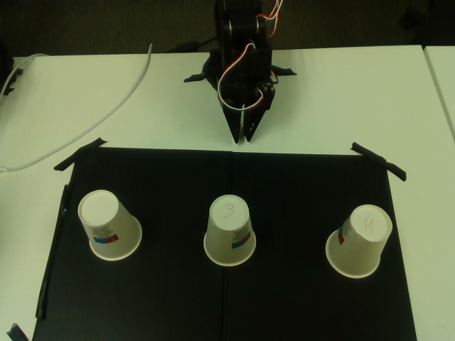
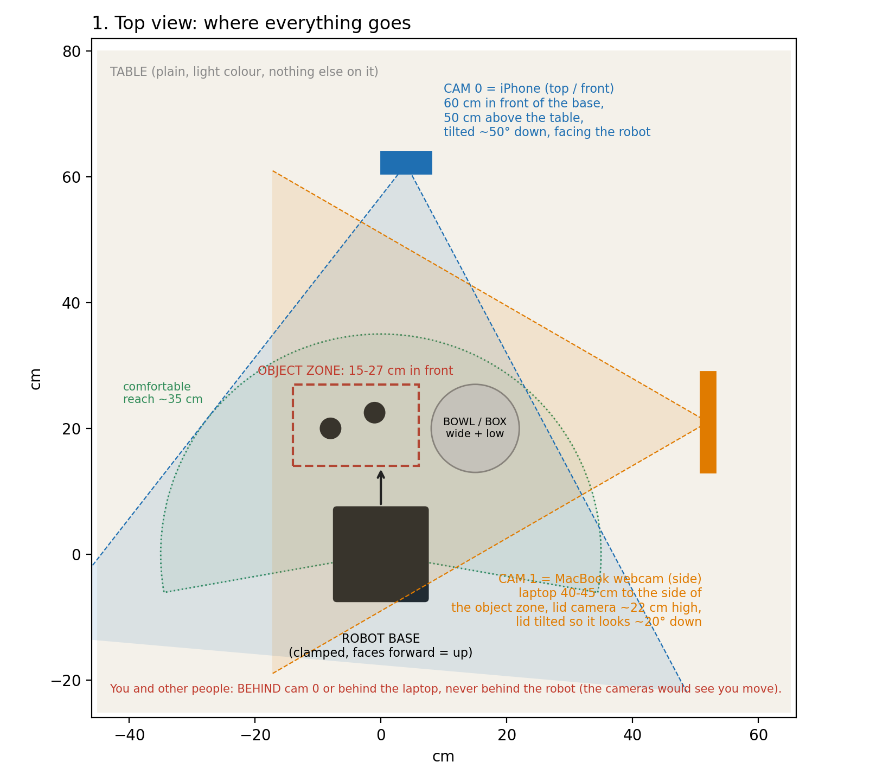
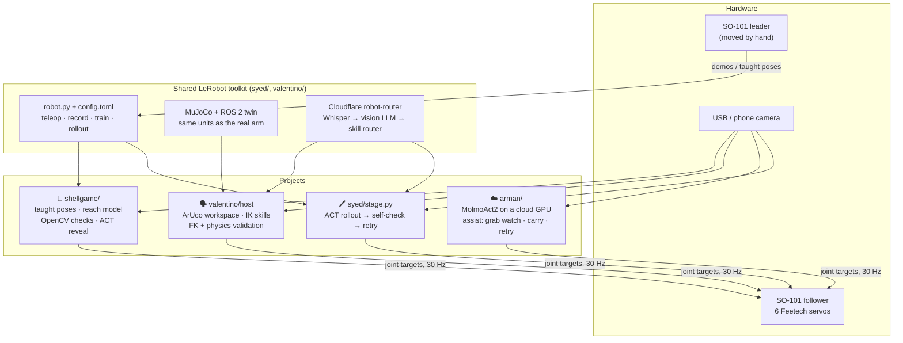
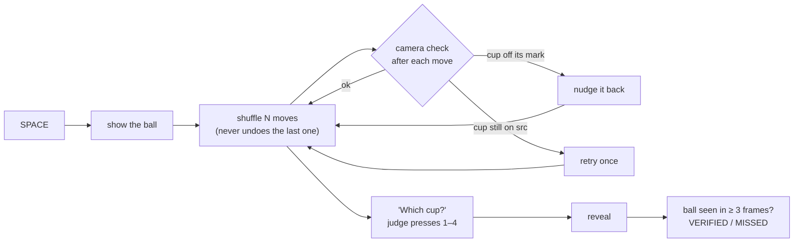
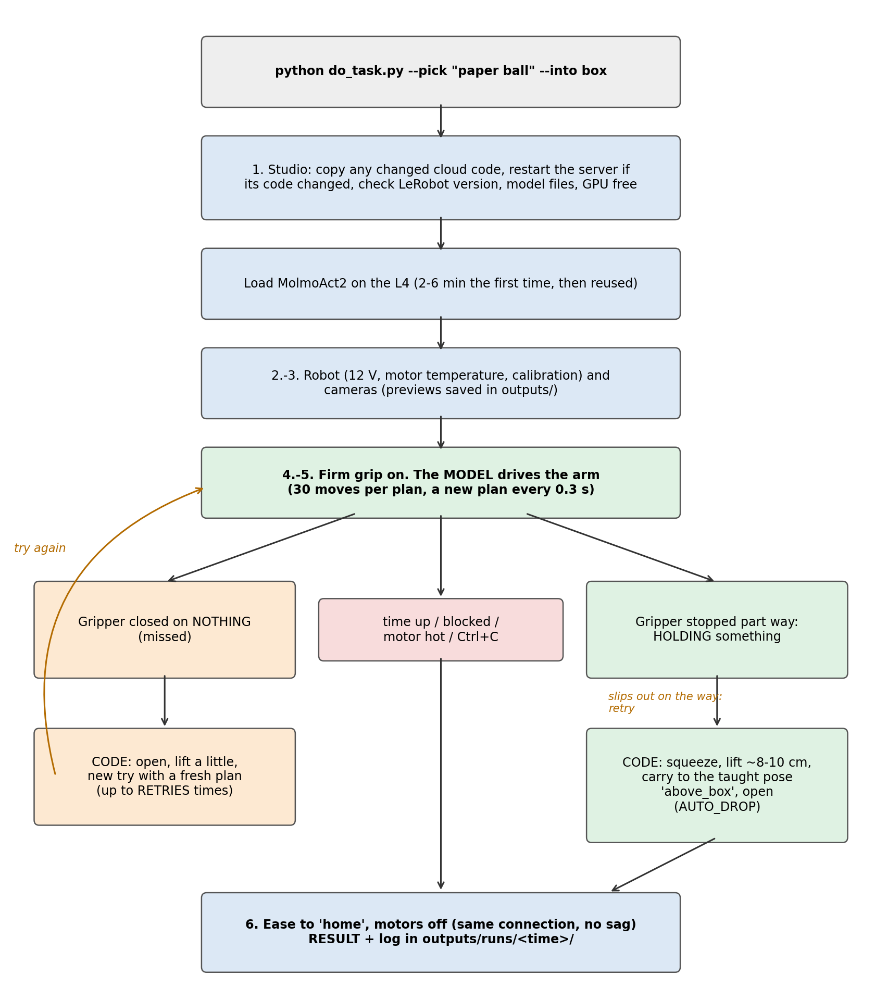

<h1 align="center">HickHack: Teaching the SO-101 New Tricks</h1>

<p align="center">
  <strong>One robot arm, 24 hours, three different answers to "teach our robot something it couldn't do before".</strong><br/>
  A robot magician that proves it plays fair · language to skills without training · a cloud vision-language-action model with a safety net
</p>

<p align="center">
  
  
  
  
  
  
  
</p>

<p align="center">
  
  &nbsp;
  
</p>
<p align="center"><sub>Left: the shell game as the robot's camera sees it. Right: the table plan for the cloud VLA setup (arman/).</sub></p>

> **Summit Sprint Hackathon (AustrianStartups), 42 Vienna, 14–15 October 2026. Robotics track: "Hack the Robot".**
> *"You have 24 hours to teach our robot something it couldn't do before. … What counts is what the robot shows live on stage."*
> Hardware provided by the TU Wien Robotics Club: one SO-101 leader arm (moved by hand), one SO-101 follower arm (copies it), and a USB camera.

---

## What's in this repo

All the projects share the same robot and the same core idea: **put deterministic code you can check around
anything learned**. They differ in where the "intelligence" comes from.

| Project | The moment on stage | Where the skill comes from | Folder |
|---|---|---|---|
| 🎩 **The Robot Magician** | The robot plays the cup game against a judge, then its camera **proves** the ball is under the cup it lifts | Motions taught with the leader arm, camera-guided grasping, optional **ACT** reveal | [`shellgame/`](shellgame/) |
| 🗣️ **Language → skills, no training** | "Move the yellow duck from the top to the bottom": the system checks every claim in the request and either acts or explains why it can't | Workers AI understands the request; **inverse kinematics** plans the motion; forward kinematics and physics check it | [`valentino/`](valentino/) |
| ☁️ **Cloud VLA with a safety net** | `do_task.py --pick "paper ball" --into box`: a large vision-language-action model drives the arm, and code takes over for the parts that must not fail | **MolmoAct2** on a Lightning AI GPU, plus grab detection, carry, retry and logging | [`arman/`](arman/) |
| 🖊️ **"The robot you can't trip up"** | A judge moves the pen mid-reach; the arm follows, lifts it, and the camera says **VERIFIED** (or retries) | **ACT** trained on teleop demos, plus a camera self-check and retry loop with a 20-position evaluation | [`syed/`](syed/) |

Underneath them is a shared **LeRobot toolkit**: one config-driven CLI for teleop → record → train → rollout on Windows, a
MuJoCo + ROS 2 digital twin, and a Cloudflare voice/text router with a live dashboard (in `syed/` and `valentino/`).

---

## Architecture at a glance



---

## 🎩 The Robot Magician: shell game · [`shellgame/`](shellgame/)

The robot shows the ball, **slides** three cups around four marked spots (the ball travels inside its cup),
asks *"Which cup is the ball under?"*, and lifts the cup the judge chose. While the cup is in the air, the camera
looks for the ball, and the screen shows **VERIFIED** or **MISSED**. A person running a shell game depends on
misdirection; this robot tracks the ball in code and puts the proof on screen.



| Part | How it works |
|---|---|
| [`game.py`](shellgame/game.py) | Pure game logic with no hardware. Legal moves always go into the empty spot, and the ball's cup moves at least `n // 3` times. |
| [`motions.py`](shellgame/motions.py) | Cups are slid along an inner lane (`above → grip → close → in_src → in_dst → grip_dst → open`), with the gripper squeezed 6 units past the taught grip so the cup doesn't slip. Moves are smooth ease-in/out curves at 30 Hz. |
| [`teach.py`](shellgame/teach.py) | All 18 poses (`home`, `ready`, `above/grip/in/lift` × 4 spots) are taught by hand with the leader arm. No coordinates are hard-coded. |
| [`vision.py`](shellgame/vision.py) | Deterministic OpenCV with no AI model. Cups are whatever is clearly brighter than a reference photo of the **empty board**, normalised so auto exposure doesn't matter. |
| [`reach.py`](shellgame/reach.py) | `--seen` mode: the camera finds each cup, and a ridge polynomial plus **thin-plate spline** maps its image position (u, v) to joint poses. It hits every taught example exactly. |
| [`act_reveal.py`](shellgame/act_reveal.py) | `--act-reveal`: an **ACT** policy (`pick_cup`, ~50 teleop demos) lifts the cup instead. If the rollout fails, the scripted reveal runs. |

```powershell
.venv\Scripts\python shellgame\test_game.py; .venv\Scripts\python shellgame\test_vision.py; .venv\Scripts\python shellgame\test_reach.py
.venv\Scripts\python shellgame\show.py --fake --no-vision --auto     # one full game, no hardware
.venv\Scripts\python shellgame\show.py --seen --fullscreen           # the real show: SPACE · 1–4 · ESC stop
```

Details: [shellgame/README.md](shellgame/README.md) · interfaces: [shellgame/CONTRACT.md](shellgame/CONTRACT.md).
It uses `robot.py`, `stage.py`, `selfcheck.py` and the calibration from [`syed/`](syed/).

---

## 🗣️ Language → skills without training · [`valentino/`](valentino/)

Instead of recording 50 demos per skill, this approach **plans every motion on the spot** from what the camera sees,
and lets a language model choose *what* to do, never *how* to move.

- **[`workspace.py`](valentino/host/workspace.py):** objects lie on a printed A4 mat with an **ArUco marker** in each corner. Every look fits camera pixels → table plane, so the camera may be moved or bumped between commands. The mat's position relative to the robot is measured once by touching two markers with the gripper tip.
- **[`skills.py`](valentino/host/skills.py):** `look, pick, place, flip, rotate, move, stack, point, wave, nod, shake`, each planned with **inverse kinematics** on the MuJoCo SO-101 model. A plan is a JSON list such as `[{"skill": "flip", "object": 1}]`. `run_plan()` validates every field, re-locates the object before each step and stops at the first failure. The same code drives the sim and the real arm.
- **[`validate_move.py`](valentino/host/validate_move.py):** before anything moves, it plans "put object N into box L" on a dry-run arm, runs **forward kinematics** on every 30 Hz target to check the gripper path, can replay the plan in **MuJoCo physics**, and draws the predicted path over the camera image.
- **[`page_grid.py`](valentino/host/page_grid.py):** a hand-drawn page with 9 named spots. *"Move the yellow duck from the top to the bottom"* → the vision model extracts `{object, colour, from, to}` → code finds the circles and the object and checks every claim. The result is a concrete move or a list of reasons why not.
- **[`intent_test.py`](valentino/host/intent_test.py):** reports how sure the model really is. It asks the same question N times at temperature 0.7 and reports the **agreement**, next to the model's own (usually over-confident) estimate.
- **SmolVLA** next to ACT in `robot.py` (`train --type smolvla`, locally or on HF Jobs), with real-time chunking at rollout.

```powershell
cd valentino
.venv\Scripts\python host\skills.py sim '[{"skill":"flip","object":1,"times":3}]' --show     # try a plan in the sim
.venv\Scripts\python host\validate_move.py --sim --obj cube --instruction "put the red cube in box Z"
.venv\Scripts\python host\page_grid.py --spots-only
```

Details: [valentino/README.md](valentino/README.md).

---

## ☁️ Cloud VLA with a safety net · [`arman/`](arman/)



**MolmoAct2**, a large vision-language-action model, runs on a **Lightning AI GPU** and drives the arm from camera
images and a sentence. A MacBook runs the robot; everything that must not fail is handled by code.

- **One command:** `python do_task.py --pick "paper ball" --into box` checks the cloud server, the robot (12 V, motor temperature, calibration) and the cameras, then lets the model drive (30 moves per plan, a new plan every 0.3 s).
- **[`assist.py`](arman/assist.py), the safety net:**
  - **Grab watch** compares the commanded gripper with the real one to detect *holding / missed / dropped / released*.
  - **Carry:** once it's holding, code lifts the object and carries it to a taught drop pose.
  - **Retry:** after a miss it opens, lifts and lets the model try again.
  - **Firmer grip:** starts the gripper motor at 45% power instead of LeRobot's 25%.
  - **Run log:** every run is logged to `outputs/runs/<time>/`.
- **[`cloud/molmo_server.py`](arman/cloud/molmo_server.py)** extends LeRobot's policy server so MolmoAct2 works with it:
  - Loads the model **once** instead of on every connection (~100 s saved per task).
  - Plans on every request.
  - Fills the second camera slot when only one camera is available.
  - Keeps images at the model's native 378×378 instead of squeezing them to 224×224.
- **Fine-tuning** on our own demos on the Studio (`scripts/train_molmo.sh`): action expert only, or LoRA.
- **Taught pick-and-place** (`pick_place.py`, `teach_pawn.py`): chess pieces into a cup from poses shown with the joystick. This is the guaranteed fallback demo.
- **Robust bring-up on macOS:** guided calibration without a "middle pose" (`calibrate.py`), leader/follower offset alignment, a RealSense colour bridge, and a pre-flight `check.py`.

```bash
cd arman && scripts/setup_mac.sh && source .venv/bin/activate
python check.py                                   # pre-flight, never moves the arm
python do_task.py --fake                          # whole chain with a fake robot
python do_task.py --pick "paper ball" --into box  # the real run (Terminal app: macOS camera permission)
```

Details: [arman/README.md](arman/README.md) · plan: [arman/PLAN.md](arman/PLAN.md) · printable playbook: [SO101_Task_Playbook.pdf](arman/docs/SO101_Task_Playbook.pdf).

<br clear="right"/>

---

## 🖊️ "The robot you can't trip up" + the shared toolkit · [`syed/`](syed/)

The team task *"Pick up the pen"*: a judge slides the pen with a stick while the arm reaches for it. The recording
protocol adds disturbance demos to the clean ones, and at rollout the **ACT** policy re-plans every 0.67 s
(`n_action_steps = 20` instead of ACT's default 100). A camera
self-check (*"pen held in the air for 1 s?"*) decides **VERIFIED** or retries, up to 3 attempts. As a last
resort, a perfect recorded demo is replayed.

| Piece | What it does |
|---|---|
| [`robot.py`](syed/robot.py) + [`config.toml`](syed/config.toml) | One CLI that builds every `lerobot-*` command from one config, so ports, calibration ids and cameras are identical between recording and rollout. `config.local.toml` overrides per laptop. |
| [`train_win.py`](syed/train_win.py) | Fixes `lerobot-train` crashing on Windows at the first checkpoint (`WinError 1314`) by using a directory junction instead of a symlink. |
| [`stage.py`](syed/stage.py) · [`selfcheck.py`](syed/selfcheck.py) | Rollout → camera self-check → retry on a big status screen; a **20-position evaluation** logged to CSV; `report` ranks checkpoint × reactivity setting. |
| [`rollout_live.py`](syed/rollout_live.py) | Hooks the rollout's own camera reads, so the stage screen can show what the policy sees (Windows lets only one process hold a webcam). |
| [`sim/`](syed/sim/README.md) · [`ros2_ws/`](syed/ros2_ws) | MuJoCo + ROS 2 Jazzy twin in **the real robot's LeRobot units**, checked against real Hugging Face datasets. A scripted IK expert generates demos. |
| [`cloudflare/robot-router`](syed/cloudflare/robot-router/README.md) | Voice/text → Whisper → vision LLM (scene) → Llama 3.3 router in JSON mode, **restricted to a fixed list of skill names**, with confidence and busy guardrails, a live dashboard and a read-only arm view. Camera frames for motor control never leave the laptop. |

Guides: [real-arm bring-up](syed/docs/real_arm_guide.md) · [stage demo protocol](syed/docs/stage_demo.md) · [router architecture](syed/docs/architecture.md).

---

## How the approaches compare

| | 🎩 Shell game | 🗣️ Language → skills | ☁️ Cloud VLA | 🖊️ Pen + ACT |
|---|---|---|---|---|
| Learning | Taught poses + fitted reach model; optional ACT | None: IK planning | Pretrained VLA (+ optional fine-tune) | ACT (protocol: 50 clean + 20 disturbance demos) |
| Understands language | — | ✅ via Workers AI | ✅ the model reads the task | via the router (skill choice) |
| GPU needed | No (ACT reveal: yes) | No | Cloud GPU | Local GPU for training |
| Reliability layer | Camera check after every move, nudge, retry | Validates every claim, FK + physics before moving | Grab watch, carry, retry | Camera self-check, retry, replay |
| Platform | Windows | Windows | macOS + Lightning AI | Windows |

---

## Results (measured)

Every number below comes from this repository; the source is linked.

| What | Result | Source |
|---|---|---|
| Shell game: hardware-free tests (`test_game`, `test_vision`, `test_reach`) | **20 / 20 passing** | [`shellgame/test_*.py`](shellgame/) |
| Sim: scripted IK expert, pen / cube (20 seeds each) | **20/20** / **19/20** lifted | [sim README](syed/sim/README.md) |
| Sim: ACT on 50 demos, 10k steps, 20 unseen pen positions | **15/20 lifted** ≥ 4 cm, 11/20 still held at the end | [sim README](syed/sim/README.md) |
| Cloudflare router, real Workers AI calls (local + sim) | all 8 checks as expected: right skill, out-of-scope requests refused, busy robot rejects | [router README](syed/cloudflare/robot-router/README.md) |
| SmolVLA on a GTX 1650 (4 GB) | inference ~1.0 s per 50-step chunk, 1.0 GiB; fine-tuning 1.12 s/step at batch 4 | [valentino README](valentino/README.md) |
| ACT on an M2 Mac | trains at ~1.25 steps/s; inference 60 ms per 100-step plan | [arman/PLAN.md](arman/PLAN.md) |
| MolmoAct2 server | loads once in 2–6 min, then a new plan every 0.3 s | [arman/README.md](arman/README.md) |

<details>
<summary><b>GPU training benchmarks (ACT, LeRobot 0.6.1)</b></summary>

GTX 1650 (4 GB), `lerobot/svla_so101_pickplace`, 640×480:

| batch | AMP | s/step | GPU mem | note |
|---|---|---|---|---|
| 8 (2 cams) | on | 4.9 | 3.55 GB | spills into system RAM |
| **4** (2 cams) | **off** | **0.51** | 2.17 GB | use this with 2 cameras |
| **8** (1 cam) | **off** | **0.48** | 1.99 GB | default in `config.toml` |
| 16 (1 cam) | off | 6.4 | 3.41 GB | spills |

RTX 3060 Laptop (6 GB), 2 cameras: batch 8 + AMP on = **0.26 s/step, 3.6 GB**. Batch 16 spills into system RAM and runs 16× slower.

Keep AMP **off** on GTX 16xx cards (no tensor cores, so fp16 is about 5× slower). Stay under the card's memory: Windows silently
spills into system RAM and each step gets about 10× slower instead of failing. 20k steps take about 2.7 h on the 1650.
</details>

---

## Getting started

Each folder is self-contained and has its own install steps:

| Folder | Platform | Install |
|---|---|---|
| `syed/`, `valentino/`, `shellgame/` | Windows · Python 3.12 · LeRobot 0.6.1 · CUDA PyTorch | [syed/README.md § Install](syed/README.md) (`uv` venv, cu128 torch, `lerobot[core-scripts,feetech,training]==0.6.1`) |
| `arman/` | macOS (M-series) · Python 3.12 · LeRobot 0.6.1 | `scripts/setup_mac.sh` ([arman/README.md](arman/README.md)) |

Then, for any approach: find the ports, calibrate both arms once, and teleoperate to check the follower copies the leader:

```powershell
.venv\Scripts\python syed\robot.py find-port
.venv\Scripts\python syed\robot.py calibrate follower
.venv\Scripts\python syed\robot.py calibrate leader
.venv\Scripts\python syed\robot.py teleop
```

Calibration files are committed (`syed/calibration/`, `valentino/calibration/`, `arman/saved_setup/`), so every laptop maps the joints exactly as they were during recording.

---

## Safety

- **Limited step size:** every approach caps how far a joint may move per command (`max_relative_target`: 10° in the shell game, 8° in valentino's skills, 15° in `arman/`).
- **Clean stops:** every script ends by easing to `home` and switching the motors off; Ctrl+C and crashes do the same. ESC in the stage screens freezes the arm where it is.
- **Language never moves the arm directly:** LLMs only ever pick from a closed list of skills (JSON-schema `enum`), or produce a plan that code validates before anything moves.
- **Hardware guards:** `arman/` stops a run when a motor gets hot and checks the supply voltage first. The robot arm needs **12 V**; the leader stays on **5 V**.
- **Physical fallback:** unplug the follower's power supply.

---

## Repository layout

```
shellgame/     🎩 The Robot Magician: game logic, taught motions, OpenCV vision, reach model, show, ACT reveal, tests
syed/          🖊️ Pen task + shared toolkit: robot.py, config, calibration, stage runner, self-check,
               MuJoCo/ROS 2 sim, Cloudflare robot-router, docs
valentino/     🗣️ Toolkit + training-free language skills: ArUco workspace, IK skills, move validation,
               hand-drawn page grid, intent test, SmolVLA, dashboard vision-check panel
arman/         ☁️ MolmoAct2 on Lightning AI: do_task.py, assist.py, cloud server, taught pick-and-place,
               macOS calibration tools, playbook PDF
```

---

## Team

| Who | Built |
|---|---|
| **Valentino** | The shared LeRobot toolkit (`robot.py`, Windows training fix, GPU benchmarks), the MuJoCo + ROS 2 sim, the Cloudflare robot-router and dashboard, SmolVLA support, and training-free language → skills ([`valentino/`](valentino/)) |
| **Syed** | Stage self-check, retry loop and 20-position evaluation, per-laptop config, live robot-eye view, the pen task ([`syed/`](syed/)), and the Robot Magician ([`shellgame/`](shellgame/)) |
| **Arman** | The MolmoAct2 cloud VLA with its assist layer, cloud server, macOS bring-up tools and taught pick-and-place ([`arman/`](arman/)) |

---

<p align="center">
  <sub>Built in 24 hours at the Summit Sprint Hackathon, 42 Vienna · hardware by the TU Wien Robotics Club · powered by Hugging Face LeRobot</sub>
</p>
