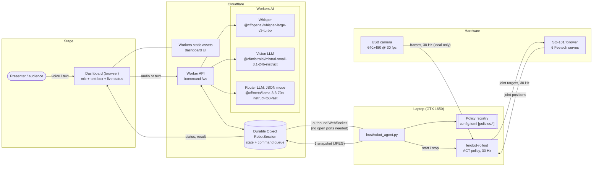
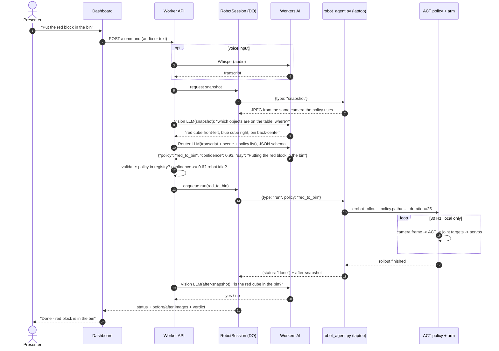
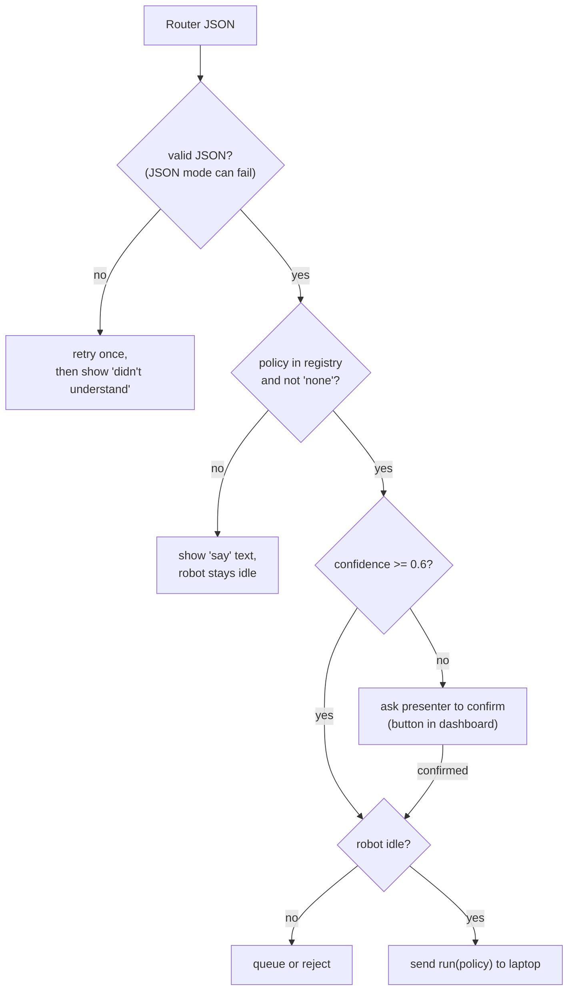

# Architecture: voice/text command → Cloudflare AI → the right policy on the arm

**Status: implemented** in [`cloudflare/robot-router`](../cloudflare/robot-router) (Worker + dashboard) and
[`host/robot_agent.py`](../host/robot_agent.py) (laptop agent). Tested locally against real Workers AI with the sim
standing in for the arm. See the Worker README for results.

## The core idea: two loops

| | Fast loop (motor control) | Slow loop (understanding) |
|---|---|---|
| Runs on | the laptop's GPU (ACT policy) | Cloudflare Workers AI |
| Rate | **30 Hz**, every camera frame | **once per command** (~1–3 s) |
| Input | live camera frames + joint positions | spoken/typed instruction + one snapshot |
| Output | 6 joint targets per step | *which* policy to run, or a refusal |

Camera frames for motor control **never leave the laptop**. Steering an arm through an internet round-trip
(100+ ms of jitter at a venue Wi-Fi) would make the grasps fail. Cloudflare only decides **what** to do. The local
policy decides **how** to move.

## 1. System overview



The laptop opens an **outbound** WebSocket to the Durable Object. That works behind venue NAT and firewalls,
with no port forwarding and no tunnel. The Durable Object is the single source of truth for the robot's state
(`idle`, `running <policy>`, `done`, `error`) and forwards it to every open dashboard.

## 2. One command, end to end



## 3. Translating an instruction into the right policy

ACT does **not** read text. Each ACT policy knows exactly one task, the one in its demos. Language gets
"understood" by **routing**: an LLM picks one entry from a closed list of trained policies. It never sends motor commands.

### 3a. Policy registry (proposed addition to `config.toml`)

Each entry is a separately trained ACT policy: its own dataset, its own `robot.py train` run.

```toml
[policies.red_to_bin]
path = "outputs/train/act_red_to_bin/checkpoints/last/pretrained_model"
task = "Pick up the red cube and place it in the bin"
description = "Moves the RED cube into the bin. Needs a red cube on the table."
duration_s = 25

[policies.blue_to_bin]
path = "outputs/train/act_blue_to_bin/checkpoints/last/pretrained_model"
task = "Pick up the blue cube and place it in the bin"
description = "Moves the BLUE cube into the bin. Needs a blue cube on the table."
duration_s = 25

[policies.wave]
replay_episode = 3          # no policy: replays a recorded demo (always works on stage)
description = "Waves hello at the audience."
```

The Worker gets only `name` + `description` from the agent when it connects, so adding a policy never needs a
Worker redeploy.

### 3b. Router call (Workers AI, JSON mode)

```ts
const result = await env.AI.run("@cf/meta/llama-3.3-70b-instruct-fp8-fast", {
  messages: [
    { role: "system", content:
      "You control a robot arm that can ONLY run these skills:\n" +
      skills.map(s => `- ${s.name}: ${s.description}`).join("\n") +
      "\nScene seen by the camera: " + sceneDescription +
      "\nPick exactly one skill, or 'none' if no skill matches or the needed object is missing." },
    { role: "user", content: transcript },
  ],
  response_format: {
    type: "json_schema",
    json_schema: {
      type: "object",
      properties: {
        policy:     { type: "string", enum: [...skills.map(s => s.name), "none"] },
        confidence: { type: "number" },
        say:        { type: "string" },   // short sentence for the dashboard / TTS
      },
      required: ["policy", "confidence", "say"],
    },
  },
});
```

### 3c. Guardrails (in the Worker, not in the prompt)



The LLM can only ever choose from the `enum`. It can't invent a movement or bypass the whitelist.
An **emergency stop** button in the dashboard sends `{type: "stop"}`, and the agent kills the rollout process.
The physical fallback is to unplug the follower's power.

## 4. What changes in the robot pipeline

| Piece | Change |
|---|---|
| Datasets | **one dataset per skill** (`robot.py record --dataset red_to_bin`, …). ~50 episodes each. Fewer skills done well beat many done badly. |
| Training | one `robot.py train --dataset X --policy act_X` per skill, ~2.7 h each on the GTX 1650. Run them back to back. |
| `robot_agent.py` (new) | WebSocket client: on `snapshot`, grab a JPEG from the camera; on `run`, call `robot.py rollout --policy <path>`; on `stop`, kill it; report status. **The camera must be released before the rollout opens it** (only one process can hold a webcam on Windows). |
| `robot.py rollout` | already supports `--policy <path>` and `--duration`. No change needed. |

**Alternative to many ACT policies: SmolVLA.** One model takes the text instruction directly
(`--policy.path=lerobot/smolvla_base`). That's more elegant, but the organizers' estimate is about 4 h for 20k steps
**on an A100**, and a 4 GB GTX 1650 can neither train nor comfortably run it. Routing between ACT policies is the
safe choice for this hardware.

## 5. Failure modes on stage

| Failure | What happens |
|---|---|
| Venue Wi-Fi drops | Agent falls back to a local keyboard menu (`1` = red_to_bin, `2` = blue_to_bin, …). The demo still runs. |
| Workers AI slow or erroring | Dashboard text box bypass: typed skill name skips the LLM. |
| Policy misses the grasp | After-snapshot check says "no". The dashboard offers *retry*. |
| Everything fails | `robot.py replay --episode N` replays a perfect recorded demo. |

## 6. Build order (fits the 24 h)

1. **First, one skill working locally** (`record` → `train` → `rollout`). Nothing below matters without it.
2. Start recording + training skill 2 while building the cloud part.
3. Worker + Durable Object + `robot_agent.py` with text input only (no AI): typed skill name → rollout.
4. Add the Router LLM (JSON mode), then Whisper, then the vision before/after check.
5. Dashboard polish: live status, before/after snapshots, the `say` text.

Model IDs were checked against the Workers AI catalog on 2026-10-14. Re-check them in the Cloudflare dashboard,
because the catalog changes often.
